<div align="center">

# 🧠 Multi-Class Brain Tumor Classification from MRI

### ResNet50V2 Transfer Learning · Two-Stage Augmentation · Grad-CAM Explainability · Cross-Dataset Validation

[](https://doi.org/10.22214/ijraset.2026.79816)
[](https://doi.org/10.22214/ijraset.2026.79816)


[](https://www.kaggle.com/code/shalmamuji/mri-brain-tumor-classification)

**Internal accuracy 89.68% · Macro-AUC 0.9820 · Cohen's κ 0.8595 · External accuracy 84.52% (no retraining)**

</div>

---

## 📖 Overview

Accurate classification of brain tumors from MRI is critical for treatment planning, yet it is hard: tumor classes look alike, datasets are small and imbalanced, and models often fail when images come from a different scanner or protocol.

This project implements a **two-phase transfer learning framework** built on **ResNet50V2 (ImageNet-pretrained)** that classifies brain MRI slices into four classes:

| Class | Description |
|---|---|
| **Glioma** | Tumor arising within the brain parenchyma |
| **Meningioma** | Tumor arising from the meningeal lining |
| **Pituitary** | Tumor in the pituitary region (sella turcica) |
| **Normal** | No tumor |

### ✨ Key Contributions

1. **Two-phase transfer learning** — frozen-backbone training followed by fine-tuning of the full `conv5` block.
2. **Two-stage augmentation with quantitative quality validation** — offline degradation (noise, blur, low-resolution) checked with SNR / PSNR / SSIM, plus online geometric augmentation.
3. **Cross-dataset validation** — evaluated on an independent CE-MRI benchmark (n = 394) **without retraining**, with McNemar's test and bootstrap AUC confidence intervals.
4. **Grad-CAM explainability** — heatmaps show anatomically consistent attention for all four classes.
5. **Balanced class weighting** — corrects the 2.08× class imbalance, penalising misclassification of healthy tissue more heavily.

---

## 🏆 Results at a Glance

| Evaluation | Dataset | n | Accuracy | Cohen's κ | Macro-AUC |
|---|---|---:|---:|---:|---:|
| **Internal (held-out test)** | Daneshmand | 310 | **89.68%** | 0.8595 | **0.9820** |
| **External (no retraining)** | CE-MRI | 394 | **84.52%** | 0.7903 | **0.9729** |

> McNemar's test between internal and external error patterns gave **p = 0.1882** (no statistically significant difference), and the macro-AUC dropped by only **0.0091**, indicating that the model's discriminative ranking generalises well across imaging sources.

### Per-Class Performance (Internal Test Set, n = 310)

| Class | Precision | Recall | F1 | Support |
|---|---:|---:|---:|---:|
| Glioma | 0.9277 | 0.8556 | 0.8902 | 90 |
| Meningioma | 0.8462 | 0.8462 | 0.8462 | 91 |
| Normal | 0.9773 | 0.9773 | 0.9773 | 44 |
| Pituitary | 0.8804 | 0.9529 | 0.9153 | 85 |
| **Macro avg** | 0.9079 | 0.9080 | 0.9072 | 310 |
| **Weighted avg** | 0.8972 | 0.8968 | 0.8958 | 310 |

### Per-Class Clinical Metrics

| Class | Sensitivity | Specificity | PPV | NPV |
|---|---:|---:|---:|---:|
| Glioma | 0.8556 | 0.9727 | 0.9277 | 0.9427 |
| Meningioma | 0.8462 | 0.9361 | 0.8462 | 0.9361 |
| Normal | 0.9773 | 0.9962 | 0.9773 | 0.9962 |
| Pituitary | 0.9529 | 0.9511 | 0.8804 | 0.9817 |

### AUC with 95% Bootstrap Confidence Intervals (1,000 iterations)

| Class | Internal AUC | 95% CI | External AUC | 95% CI |
|---|---:|---|---:|---|
| Glioma | 0.9651 | [0.9369–0.9863] | 0.9589 | [0.9384–0.9763] |
| Meningioma | 0.9710 | [0.9546–0.9849] | 0.9639 | [0.9401–0.9826] |
| Normal | 0.9975 | [0.9920–1.0000] | 0.9792 | [0.9673–0.9888] |
| Pituitary | 0.9937 | [0.9876–0.9983] | 0.9901 | [0.9829–0.9954] |
| **Macro avg** | **0.9820** | — | **0.9729** | — |

### Comparison with Prior Work

| Method | Architecture | Classes | Accuracy | External Validation |
|---|---|:---:|---:|:---:|
| Cheng et al. | SVM + BoW | 4 | 84.19% | ❌ |
| Abiwinanda et al. | CNN | 3 | 84.19% | ❌ |
| Deepak & Ameer | GoogLeNet | 3 | 92.12% | ❌ |
| Khan et al. | ResNet50 | 4 | 90.67% | ❌ |
| Rehman et al. | VGG19 | 3 | 95.00% | ❌ |
| Sultan et al. | CNN | 2 | 96.56% | ❌ |
| **This work** | **ResNet50V2** | **4** | **89.68%** | ✅ |

> ⚠️ Prior-work numbers come from different datasets, class counts, and protocols, so they are not directly comparable. The distinguishing factor of this work is **external cross-dataset validation** and explainability, not raw single-dataset accuracy.

---

## 🔬 Method

```mermaid
flowchart LR
    A[Brain MRI<br/>256×256 RGB] --> B[Stratified split<br/>72 / 18 / 10]
    B --> C[Stage 1: Offline degradation<br/>noise · blur · low-res<br/>2,228 → 4,456 images]
    C --> D[Stage 2: Online geometric<br/>rotation · shift · zoom · flip]
    D --> E[ResNet50V2<br/>224×224×3]
    E --> F[GAP → Dense 1024 → Dropout 0.5 → Softmax 4]
    F --> G[Phase 1: Frozen base]
    G --> H[Phase 2: Fine-tune conv5 block]
    H --> I[Evaluation<br/>Internal + External]
    I --> J[Grad-CAM]
```



### 1. Datasets

| Role | Dataset | Images | Notes |
|---|---|---:|---|
| **Training / Validation / Test** | [Brain MRI Images for Brain Tumor Detection](https://www.kaggle.com/datasets/susandaneshmand/mri-images) (Daneshmand) | 3,096 | T1-weighted, 256×256 RGB, zero corrupted files |
| **External validation only** | [Brain Tumor Classification (MRI)](https://www.kaggle.com/datasets/sartajbhuvaji/brain-tumor-classification-mri) (CE-MRI) | 394 | Never used in training or validation |

**Class distribution (Daneshmand):** glioma 901 (29.1%) · meningioma 913 (29.5%) · normal 438 (14.1%) · pituitary 844 (27.3%) — an imbalance ratio of **2.08×**.

**Split (stratified, zero file overlap verified by filepath intersection):**

| Split | Total | Glioma | Meningioma | Normal | Pituitary |
|---|---:|---:|---:|---:|---:|
| Training | 2,228 | 649 | 657 | 315 | 607 |
| Validation | 558 | 162 | 165 | 79 | 152 |
| Test | 310 | 90 | 91 | 44 | 85 |
| **Total** | **3,096** | 901 | 913 | 438 | 844 |

### 2. Two-Stage Augmentation

**Stage 1 — Offline degradation** (training set only; 2,228 → 4,456 images, 2.00×). Simulates cross-scanner variability while preserving diagnostic structure.

| Method | Parameter | SNR (dB) | PSNR (dB) | SSIM |
|---|---|---:|---:|---:|
| Gaussian noise | μ=0, σ=10 | 18.39 | — | — |
| Gaussian blur | k = 3×3 | — | 36.80 | 0.9794 |
| Gaussian blur | k = 5×5 | — | 32.79 | 0.9519 |
| Gaussian blur | k = 7×7 | — | 29.39 | 0.9050 |
| Low resolution | scale = 70% | — | 35.85 | 0.9747 |
| Low resolution | scale = 50% | — | 32.70 | 0.9497 |
| Low resolution | scale = 30% | — | 27.08 | 0.8543 |

All augmented samples maintain **SSIM ≥ 0.85**. Low-resolution degradation uses `INTER_AREA` downsampling followed by `INTER_LINEAR` upsampling back to the original size.

**Stage 2 — Online geometric augmentation** (applied dynamically during training): rotation ±20°, width/height shift ±10%, zoom ±10%, horizontal flip.

### 3. Model Architecture

- **Backbone:** ResNet50V2, ImageNet-pretrained (190 layers, 23.56M parameters, 7×7×2048 feature map)
- **Head:** `GlobalAveragePooling → Dense(1024, ReLU) → Dropout(0.5) → Dense(4, Softmax)`
- **Total parameters:** 25,675,268 (2,106,372 trainable in Phase 1)

### 4. Two-Phase Transfer Learning

| | Phase 1 — Frozen Base | Phase 2 — Fine-Tuning |
|---|---|---|
| **Trainable layers** | Classification head only | Top 30 layers (entire `conv5` block + `post_bn`) |
| **Learning rate** | 1×10⁻⁴ | 1×10⁻⁵ |
| **Epochs** | Converged at epoch 17 (max 50) | 20 |
| **Best val. accuracy** | 90.86% | **91.04%** |
| **Best val. AUC** | 0.9871 | **0.9878** |
| **Time (Tesla P100)** | 29.4 min | 19.4 min |

**Total training time: 48.8 min.** Optimiser: Adam. Callbacks: EarlyStopping (patience 15), ReduceLROnPlateau (factor 0.5, patience 3, min LR 1×10⁻⁶).

### 5. Class Imbalance Correction

Balanced class weights `wᵢ = N / (K · nᵢ)`:

| Glioma | Meningioma | Normal | Pituitary |
|---:|---:|---:|---:|
| 0.859 | 0.848 | **1.767** | 0.917 |

The elevated weight on *normal* penalises misclassification of healthy tissue roughly twice as heavily as errors on the majority tumor classes.

### 6. Grad-CAM Explainability

Gradients are extracted at `conv5_block3_out`, with heatmaps upsampled to 224×224 (bicubic) and overlaid at α = 0.4. Average heatmaps were computed over 20 samples per class.

| Class | Observed attention pattern |
|---|---|
| Glioma | Cerebral hemisphere tissue |
| Meningioma | Peripheral brain surfaces |
| Pituitary | Sella turcica region |
| Normal | Diffuse, unfocused activation |

This supports the claim that the model relies on clinically meaningful features rather than spurious image artifacts.

---

## 🔍 Error Analysis & Discussion

- **Glioma ↔ meningioma confusion is the dominant error**: 10 of 32 internal errors and 12 of 61 external errors. Both classes have overlapping intensity distributions on plain T1-weighted MRI, which is also visible in the t-SNE and pixel-intensity analyses.
- **Domain shift is modest**: a 5.16 percentage-point accuracy drop (89.68% → 84.52%) from internal to external data, while macro-AUC fell by only 0.0091.
- **Statistical checks**: McNemar's test (p = 0.1882) and an independent-samples t-test comparing Phase 1 vs Phase 2 validation accuracy (p = 0.5954) both show no significant difference.

---

## ⚙️ Setup

### Environment

| Component | Version |
|---|---|
| Python | 3.12.12 |
| TensorFlow | 2.19.0 |
| Keras | 3.13.2 |
| NumPy | 2.0.2 |
| OpenCV | 4.12.0 |
| scikit-learn | 1.6.1 |
| Hardware | Tesla P100-PCIE-16GB (mixed precision `float16`/`float32`) |
| Random seed | 42 (NumPy, TensorFlow, Python) |

### Installation

```bash
git clone <your-repository-url>
cd <your-repository-folder>

python -m venv .venv
source .venv/bin/activate        # Windows: .venv\Scripts\activate

pip install tensorflow==2.19.0 keras==3.13.2 numpy==2.0.2 \
            opencv-python==4.12.0.88 scikit-learn==1.6.1 \
            matplotlib seaborn
```

### Getting the Data

Download both datasets from Kaggle and place them in a local `data/` directory:

- Training/test: <https://www.kaggle.com/datasets/susandaneshmand/mri-images>
- External validation: <https://www.kaggle.com/datasets/sartajbhuvaji/brain-tumor-classification-mri>

### Running the Pipeline

The complete, runnable implementation is available as a Kaggle notebook:

👉 **<https://www.kaggle.com/code/shalmamuji/mri-brain-tumor-classification>**

The notebook walks through: data loading and leakage checks → augmentation and quality metrics → Phase 1 training → Phase 2 fine-tuning → internal and external evaluation → Grad-CAM.

### Hyperparameters

| Hyperparameter | Value |
|---|---|
| Input size | 224 × 224 × 3 |
| Batch size | 32 |
| Phase 1 / Phase 2 learning rate | 1×10⁻⁴ / 1×10⁻⁵ |
| Fine-tuned layers | 30 (`conv5` block) |
| Dropout rate | 0.5 |
| Dense units | 1,024 |
| Max epochs (Phase 1 / Phase 2) | 50 / 20 |
| Early-stopping patience | 15 |
| ReduceLROnPlateau (patience / factor) | 3 / 0.5 |
| Minimum LR | 1×10⁻⁶ |

---

## ⚠️ Limitations

- **2D slice inputs** — no inter-slice (3D) spatial context.
- **Plain T1-weighted MRI** — no contrast enhancement, which limits cues such as the dural tail sign.
- **Single-institution training data.**
- **No prospective clinical validation.**

> **Disclaimer:** This project is for **research and educational purposes only**. It is not a medical device and must not be used for clinical diagnosis or treatment decisions.

---

## 🛣️ Future Work

- Multi-source training that combines both dataset partitions to reduce domain shift
- Anatomy-aware Bayesian confidence-fusion module for glioma–meningioma disambiguation
- Extension to 3D volumetric MRI
- Incorporation of contrast-enhanced sequences
- Prospective multi-institution clinical validation

---

## 📚 Citation

If you use this work, please cite:

```bibtex
@article{muji2026brain,
  title   = {Multi-Class Brain Tumor Classification from MRI Using ResNet50V2 Transfer Learning
             with Two-Stage Augmentation, Grad-CAM Explainability, and Cross-Dataset Validation},
  author  = {Muji M, Shalma and T, Nithin and D, Lavanya and VS, Abhiram and Sreeja, S and Kousalya, A},
  journal = {International Journal for Research in Applied Science \& Engineering Technology (IJRASET)},
  volume  = {14},
  number  = {IV},
  month   = apr,
  year    = {2026},
  doi     = {10.22214/ijraset.2026.79816}
}
```

---

## 👥 Authors

| Name | Role |
|---|---|
| Shalma Muji M | B.Tech Student |
| Nithin T | B.Tech Student |
| Lavanya D | B.Tech Student |
| Abhiram VS | B.Tech Student |
| S Sreeja | M.E Student |
| A Kousalya | Associate Professor *(mentor)* |

Department of Artificial Intelligence and Data Science, **United Institute of Technology**, Coimbatore, Tamil Nadu, India.

## 🙏 Acknowledgments

We thank **Dr. A. Kousalya**, Associate Professor, Department of Artificial Intelligence and Data Science, United Institute of Technology, for mentorship and guidance throughout this work. Thanks also to the creators of the Daneshmand and CE-MRI datasets for making their data publicly available.

## 📄 License

<!-- Add your license here, e.g. MIT -->
This project is released under the **[LICENSE NAME]** license. See the `LICENSE` file for details.


